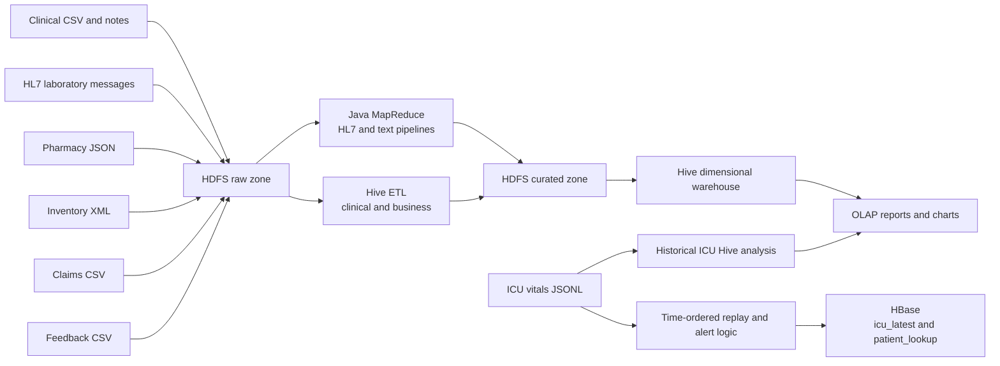
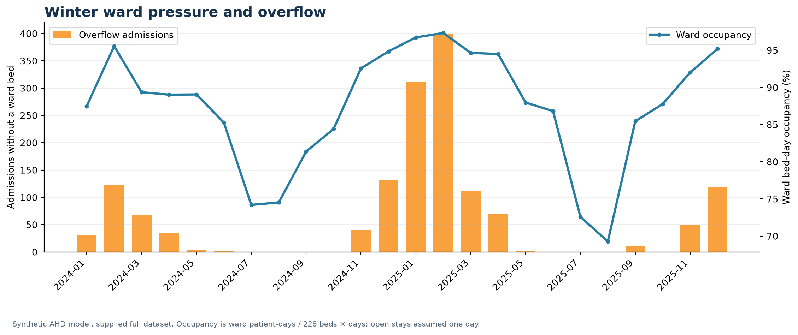
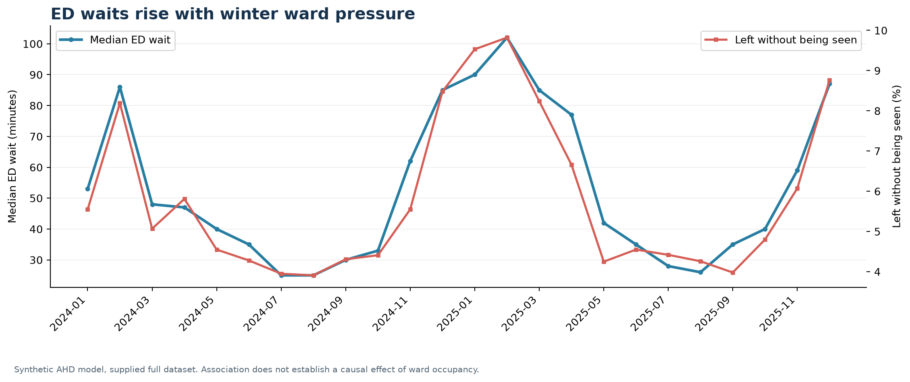
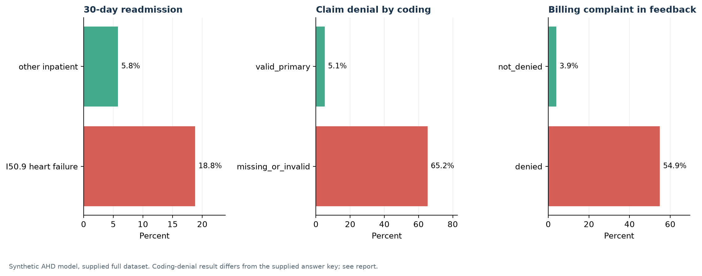
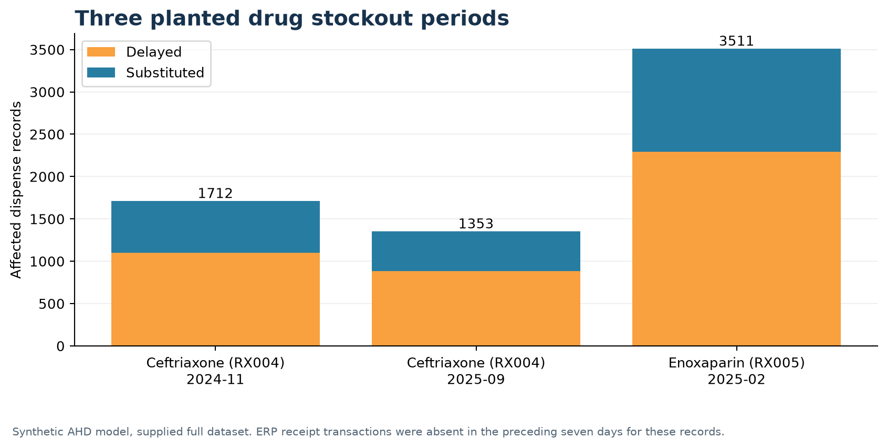
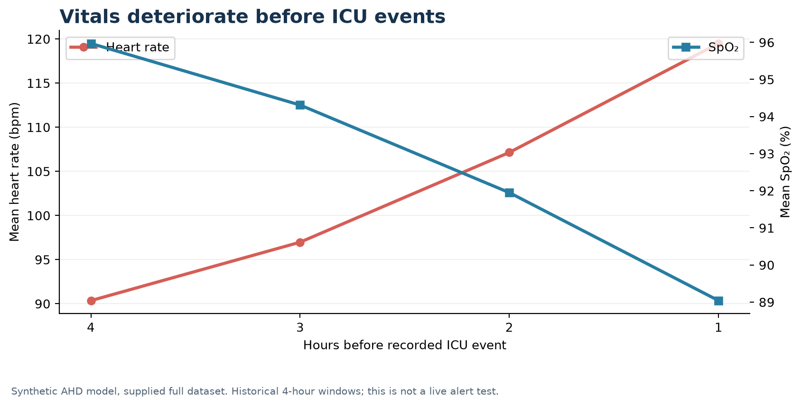
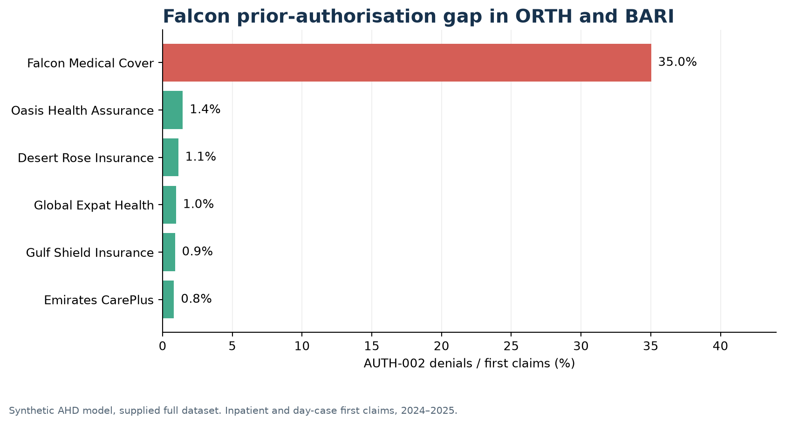
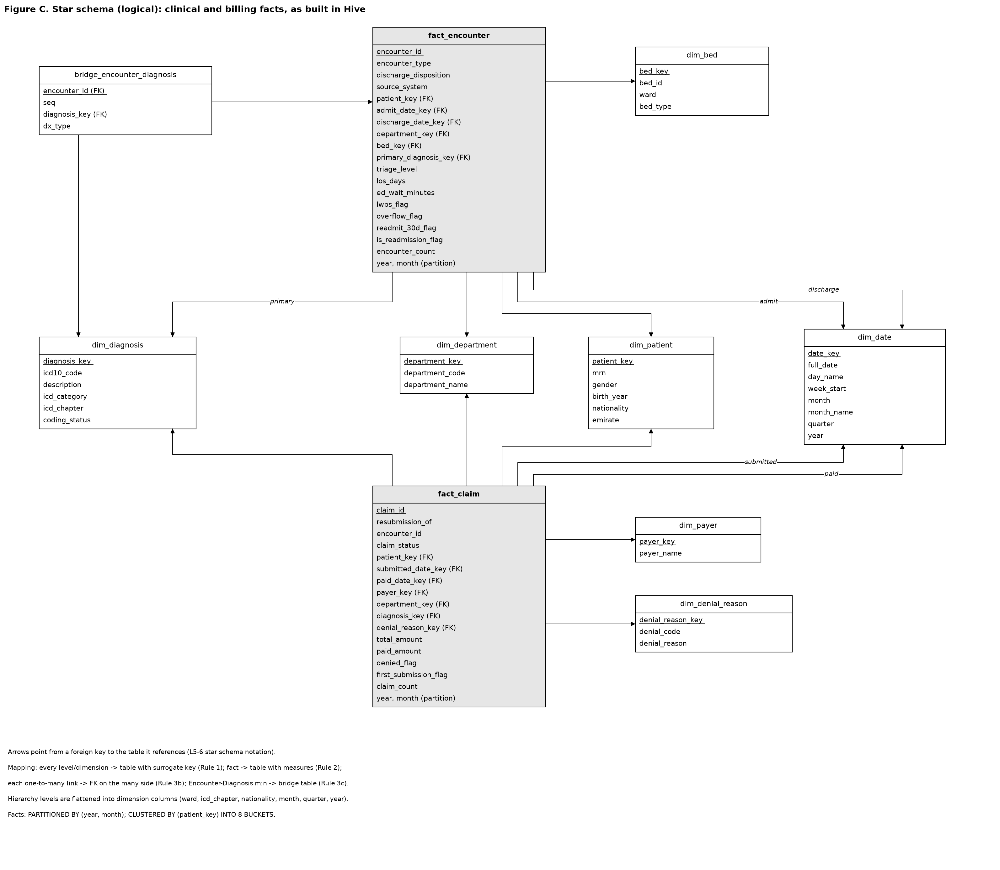
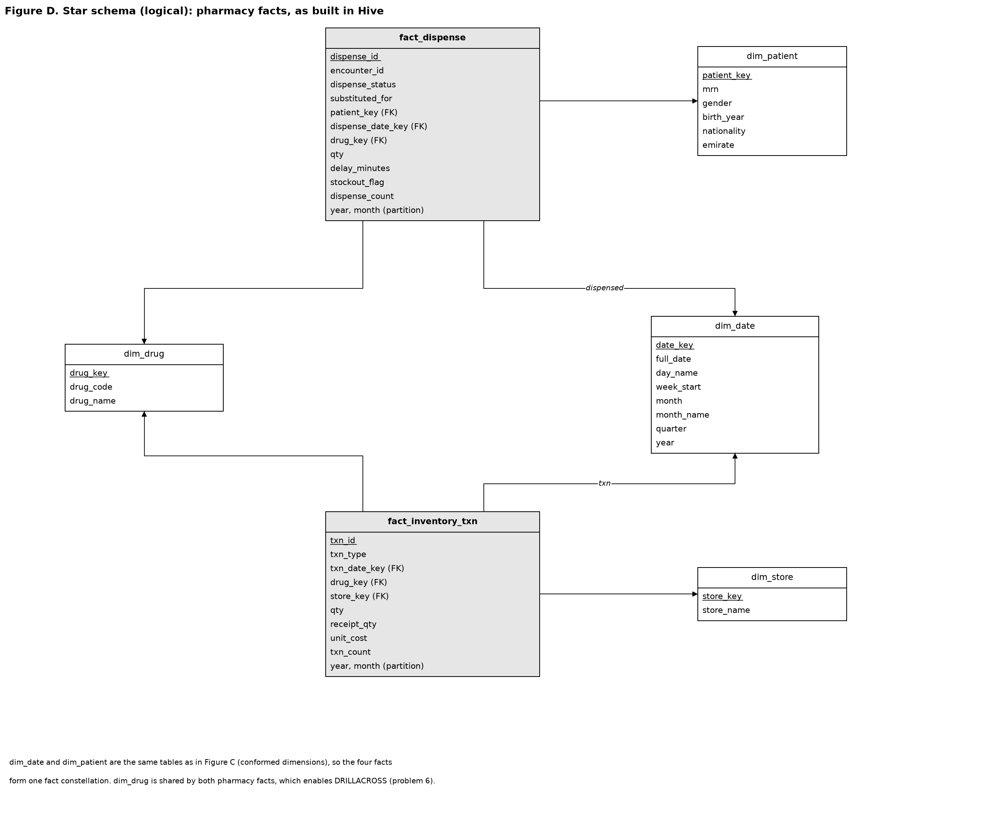

# Big Data in the Medical Field

## American Hospital Dubai Synthetic Data Lake

This repository is our eight-member ISIT312 Big Data Management group project. We designed and demonstrated a hospital data lake modelled on American Hospital Dubai's public technology landscape, covering ingestion, Java MapReduce, Hive ETL, real-time ICU processing, dimensional modelling, OLAP analytics, and HBase serving tables.

The project uses **synthetic data only**. It contains no real patient, employee, insurer, financial, or hospital operational records.

Our main lesson was simple: getting files into Hadoop was not the difficult part. The difficult part was deciding which patient, encounter, diagnosis, claim, medicine, and timestamp each row actually represented—and keeping those decisions consistent across systems.

## What we built

The solution has a batch lane for large historical analysis and a real-time lane for current ICU state. Raw source files remain unchanged, questionable records are made visible, and cleaned data moves through curated tables into a warehouse or HBase serving layer.



The three HDFS zones have distinct purposes:

- **Raw** keeps each source exactly as received.
- **Curated** contains standardized, validated, and linked data plus explicit reject records.
- **Serving** contains the dimensional warehouse for reporting and HBase tables for fast current-state lookups.

## The dataset

The supplied generator produces approximately 1.9 GB of data for 2024–2025 in CSV, JSONL, XML, and HL7 formats. The major full-data volumes used by the project were:

| Source | Full-data volume |
| --- | ---: |
| Patients | 164,697 |
| Encounters | 780,371 |
| Diagnoses | 1,296,906 |
| Clinical notes | 81,514 |
| HL7 laboratory messages | 978,256 messages / 2,857,672 results |
| Pharmacy dispenses | 1,011,013 |
| Inventory transactions | 99,299 |
| Claims | 735,391 |
| ICU vital readings | 5,510,388 |
| ICU events | 126 |
| Patient feedback | 92,593 |

The generated raw files are not committed because of their size. The repository includes the deterministic generator, schema guide, planted-pattern answer key, and 2% sample manifest under [`data/synthetic-kit`](data/synthetic-kit/).

```bash
# Full data
python3 data/synthetic-kit/generate_ahd.py --out ahd_data

# Smaller development copy
python3 data/synthetic-kit/generate_ahd.py --out ahd_data --scale 0.02
```

## Problems we found in the data

We did not clean the data by overwriting the raw files. Instead, we standardized what could be standardized safely, de-duplicated records at a defined grain, and placed uncertain records in reject tables with a reason. The reconciliation rule was:

`raw rows = curated rows + rejected rows`

| Data problem | Why it mattered | What we did |
| --- | --- | --- |
| Duplicate and legacy MRNs | One person could appear to be several patients, distorting readmission and utilization measures. | Standardized the MRN format and built `mrn_map(std_mrn, master_mrn)` so every known identifier resolves to one master patient. |
| Repeated encounters and claims | Simple joins could multiply facts and inflate rates or financial totals. | Used deterministic `ROW_NUMBER()` rules, defined the analytical grain, and counted first claims rather than resubmissions or `DUP-004` duplicates. |
| Missing or invalid primary diagnoses | A claim could not be evaluated reliably for diagnosis-related denial patterns. | Created a separate missing/invalid coding cohort and joined claims to clinical primary diagnoses using `encounter_id`. |
| Billing denial codes looked like diagnosis codes | Treating a denial reason as a diagnosis would create a false clinical result. | Kept `denial_code` strictly as a billing attribute. Clinical diagnosis came only from the diagnosis source. |
| Pharmacy schema changed between 2024 and 2025 | The same dispense appeared in two different JSON structures. | Parsed both schema versions and transformed them into one consistent curated structure. |
| Epoch timestamps and inconsistent date formats | Events from different systems would not align correctly in time. | Parsed source-specific formats, converted epoch milliseconds, and standardized timestamps to Dubai time. |
| ICU-07 and ICU-15 had a documented seven-minute clock drift | A vital reading could be joined to the wrong event window. | Corrected those timestamps during landing before joining vitals to ICU events. |
| Duplicate inventory transaction IDs and Oracle-style dates | Stock movement counts and receipt checks could be duplicated or misdated. | De-duplicated transaction IDs, parsed Oracle timestamps, preserved transaction type, and used signed movements. |
| Truncated HL7 messages and duplicate control IDs | Broken or replayed lab messages could produce incomplete or repeated results. | The MapReduce parser skipped incomplete messages, de-duplicated control IDs, and recorded counters for transparency. |
| Missing discharge timestamps | An open admission could be counted as occupying a bed for every later month. | Used a documented one-day interval for missing discharges rather than projecting the stay indefinitely. |
| English and Arabic free text | A single-language rule would miss part of the patient feedback. | Applied transparent bilingual billing-keyword rules and documented that paraphrases can still be missed. |

## What the analysis found

After cleaning and defining the grains, Member 7 implemented one Hive report for each of the eight business problems. The HQL uses `ROLLUP`, `CUBE`, `GROUPING SETS`, `RANK`, moving averages, running totals, and source-to-source joins. Each report is also expressed in OLAP algebra using operations such as `ROLLUP+`, `SLICE`, `DICE`, and `DRILLACROSS`.

| Business question | Full-data result | Why it matters |
| --- | --- | --- |
| Winter bed pressure | January and February 2025 had **311 and 400 overflow admissions**. Estimated ward occupancy reached **96.72% and 97.32%**. | The planted winter capacity problem is visible at both the admission and bed-day levels. |
| ED crowding | Exact median waits reached **90 and 102 minutes**, while **9.53% and 9.82%** left without being seen in January and February 2025. | ED delay rose alongside winter ward pressure, although the association is not proof of causation. |
| Heart-failure readmissions | The I50.9 cohort had **448/2,384 = 18.79%** readmitted, versus **2,475/42,784 = 5.78%** for other inpatients. | The cohort experienced more than three times the comparison rate. |
| Coding-related denials | Missing or invalid primary diagnosis: **16,873/25,877 = 65.20%** denied. Valid primary diagnosis: **34,343/677,044 = 5.07%**. | Diagnosis quality and denial outcome are strongly associated in the synthetic data. |
| Prior authorisation | Falcon Medical Cover had **788/2,250 = 35.02%** `AUTH-002` denials for ORTH/BARI inpatient and day-case first claims. | Comparable payer rates were roughly 0.8%–1.4%, isolating the planted authorisation problem. |
| Drug stockouts | Three periods affected **6,576 dispenses**: 1,712 and 1,353 for RX004, and 3,511 for RX005. | None had a recent receipt for the requested drug in the preceding seven days. |
| ICU deterioration | Across 126 events, mean heart rate rose from **90.35 to 119.49 bpm** while mean SpO₂ fell from **95.97% to 89.04%** before the event. | The historical trend is consistent with deterioration, but it is not a validated live warning model. |
| Billing complaints | Billing complaints occurred in **2,861/5,216 = 54.85%** of feedback linked to a denied first claim, versus **2,583/66,347 = 3.89%** for other first claims. | Claim outcome and billing-related dissatisfaction have a strong synthetic association. |

### A validation result we did not hide

The supplied answer key expected roughly 53% denial for the bad-coding cohort. The generator, however, assigns a 0.65 denial probability to that group, and the supplied full data produced **65.20%**. We reported the measured result and explained the generator logic instead of altering the result to match the key.

## Results in pictures

The charts below were generated from the committed full-data result CSVs. They are not screenshots of invented output; the associated Hive logs and terminal evidence are under [`members/member-07-olap-analytics/evidence`](members/member-07-olap-analytics/evidence/).

### Winter capacity and emergency-department pressure





### Comparative risks and billing feedback



### Pharmacy, ICU, and payer findings

| Drug stockout periods | ICU deterioration before events |
| --- | --- |
|  |  |



## Warehouse design

The updated Member 6 package builds a fact constellation rather than one oversized table. Clinical and billing measures share conformed patient, department, diagnosis, payer, bed, and date dimensions. Pharmacy dispensing and inventory facts share the drug dimension, allowing stock movements and affected dispensing records to be compared at a compatible grain.

### Clinical and billing star schema



### Pharmacy and inventory star schema



The final Member 6 adapter reads Member 4's actual `default.curated_*` tables and converts `mrn_map(std_mrn, master_mrn)` into the `mrn/canonical_mrn` interface expected by the warehouse.

## Real-time design and why one tool was not enough

MapReduce works well for complete files and historical aggregation, but an ICU monitor produces a new reading every minute. Waiting for a batch job to finish is therefore inappropriate for a sustained-condition alert. The project keeps these responsibilities separate:

- MapReduce and Hive summarize historical data and support reproducible analysis.
- A time-ordered replay demonstrates sustained HR and SpO₂ alert logic.
- HBase stores the latest state by `bed_id` and patient lookup by MRN.
- The OLAP report uses historical event windows and does not claim to be a live clinical alarm.

## Evidence and reproducibility

The repository preserves reports, source code, logs, diagrams, and screenshots rather than presenting only a final narrative.

- Members 1–6 document their course Hadoop/Hive VM work and supplied evidence.
- Member 6's updated hand-off records a full-data warehouse rebuild using the final Member 4 and Member 5 tables.
- Member 7 was independently rerun on the supplied full data in Apache Hive 4.0.1 in Docker.
- All nine Member 7 scripts—table setup plus Problems 1–8—completed without `Error:` or `FAILED:` in the committed full-run logs.
- Independent full-file calculations were used as checks and are labelled separately from Hive execution evidence.
- Three genuine Mac terminal captures show the HQL, live Tez progress, and the four-row ICU output.

Start with the [Member 7 report](members/member-07-olap-analytics/Member7_Report.pdf) for the complete analytical narrative, or inspect the [editable Markdown version](members/member-07-olap-analytics/Member7_Report.md), [HQL](members/member-07-olap-analytics/), [charts](members/member-07-olap-analytics/charts/), and [execution status](members/member-07-olap-analytics/evidence/STATUS.md).

## Repository guide and team contributions

| Member folder | Contribution | Main contents |
| --- | --- | --- |
| [`member-01-platform-ingestion`](members/member-01-platform-ingestion/) | Hadoop platform and HDFS ingestion | Implementation report and VM evidence |
| [`member-02-mapreduce`](members/member-02-mapreduce/) | MapReduce for HL7 labs and feedback text | Report, Java source, Hive DDL, build and run scripts |
| [`member-03-realtime-icu`](members/member-03-realtime-icu/) | Real-time and ICU processing | Batch-versus-streaming analysis and implementation report |
| [`member-04-hive-clinical-etl`](members/member-04-hive-clinical-etl/) | Hive ETL for clinical data | Report, HQL, execution logs, and supporting command notes |
| [`member-05-business-etl`](members/member-05-business-etl/) | Hive ETL for business data and BPMN | Report, HQL, logs, BPMN diagrams, and build tools |
| [`member-06-data-warehouse`](members/member-06-data-warehouse/) | Dimensional warehouse design | Updated report, star-schema HQL, integration adapters, diagrams, screenshots, and slides |
| [`member-07-olap-analytics`](members/member-07-olap-analytics/) | OLAP analytics and business intelligence | Eight HQL reports, OLAP algebra, full-data results, charts, genuine Hive evidence, and final report |
| [`member-08-hbase-current-state`](members/member-08-hbase-current-state/) | HBase serving layer and current-state study | HBase design, commands, and report section |

The original [project brief and university specifications](docs/requirements/) are included, and [`docs/CONTRIBUTIONS.md`](docs/CONTRIBUTIONS.md) provides a compact responsibility map.

## Limitations

This is a synthetic academic project, not a deployed clinical system. Bed occupancy is estimated from date-overlap bed days rather than observed midnight census. Missing discharges use a documented one-day assumption. Feedback classification uses transparent keywords and can miss paraphrases. The analyses show associations, not causal effects. ICU trends are historical averages, not evidence of clinical sensitivity, specificity, or production alert latency. Evidence was produced in more than one environment, so we do not claim that every component ran end to end in one cluster.

## Academic note

This public repository is provided for assessment and review of the ISIT312 group submission. No reuse licence is granted. Each member's report remains the authority for that member's exact implementation claims and limitations.
